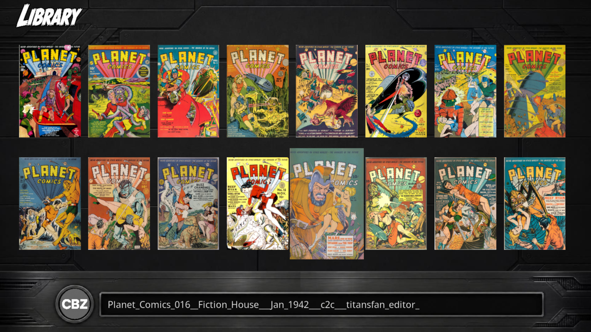
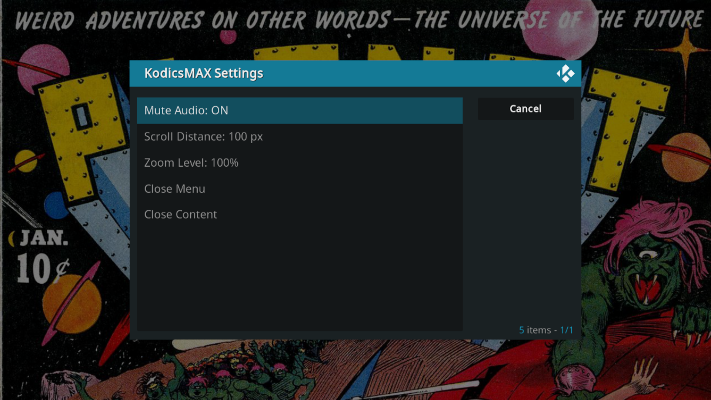

# KodicsMAX

A powerful Kodi addon for reading comic books with native support for .CBR and .CBZ file formats.

[Features](#features) • [Installation](#Installation) • [Updating](#Updating) • [Usage](#Usage) • [Issues](https://github.com/ArogueModder/KodicsMAX/issues) 

---

## About

**KodicsMAX** brings an enhanced comic reading experience to Kodi. Originally created by **typewriterMonkey** and adopted by **ArogueModder**, this addon provides support for digital comic collections.

| | |
|---|---|
| **Original Creator** | typewriterMonkey |
| **Improved By** | ArogueModder |
| **License** | GNU General Public License v3.0 |
| **Kodi Support** | v19+ |

---

##  Features

-  **Native .CBR & .CBZ Support** 
-  **Library with thumbnails of covers**
-  **Auto-page saving with badges for in-progress and complete reads**
-  **Library Theme system with the ability to create and distribute your own themes**
-  **Rolling cache for pages so your comics load quick**
-  **Stability and Compatibly improvements for a smooth and polished experience**   
-  **Custom zoom levels for detailed comic panel viewing**
-  **Customize reading speed and scroll behavior to your preference**
-  **Intuitive, user-friendly design**

---

## Installation

### Option 1: From Zip File (Recommended)

1. Download .Zip file to flash drive or similar
2. In Kodi, navigate to **Settings** → **Add-ons** → **Install from zip file**
3. Select your downloaded zip file
4. Select **Install**

### Option 2: Manual Installation

1. Download the [latest release](https://github.com/ArogueModder/KodicsMAX/releases)
2. Extract the zip file
3. Copy the `script.image.kodicsmax` folder to your Kodi add-ons directory:

   | Platform | Path |
   |----------|------|
   | **macOS** | `~/Library/Application Support/Kodi/addons/` |
   | **Linux** | `~/.kodi/addons/` |
   | **Raspberry Pi** | `~/.kodi/addons/` |

4. Restart Kodi

---

## Updating

To update KodicsMAX to a newer version:

1. **Uninstall** the previous version:
   - Go to **Settings** → **Add-ons** → **My add-ons** → **Image add-ons**
   - Select **Kodics** or **KodicsMAX**
   - Choose **Uninstall**

2. **Restart Kodi** (or reboot your system)

3. **Install the new version** following the [Installation](#installation) instructions above

---

## Usage

1. Open **KodicsMAX** from your Add-ons menu
2. Navigate to your comic library root folder and select it
3. Go back to the home screen and select library
4. Browse your library and select a comic
5. Once reader opens, press select again to access the reader menu
6. Use these controls to navigate:

## Reader Controls

### Keyboard Controls

| Action | Control |
|--------|---------|
| Navigate to Next Page | Right Arrow (→) |
| Navigate to Previous Page | Left Arrow (←) |
| Open Settings | Enter |
| Return to Library | Back / Escape |

### Remote Control

| Action | Control |
|--------|---------|
| Navigate to Next Page | Right Arrow / Forward Button |
| Navigate to Previous Page | Left Arrow / Back Button |
| Open Settings | Select Button |
| Return to Library | Back Button |

## Library Controls

### Keyboard Controls

| Action | Control |
|--------|---------|
| Navigate to Next Page | Right Arrow (→) |
| Navigate to Previous Page | Left Arrow (←) |
| Open Settings | Enter |
| Return to Library | Back / Escape |

### Remote Control

| Action | Control |
|--------|---------|
| Navigate to Next Comic | Right Arrow |
| Navigate to Previous Comic | Left Arrow |
| Navigate to Above Comic | Up Arrow |
| Navigate to Below Comic | Down Arrow |
| Open Comic | Select Button |
| Return to Library | Back Button |

## Main Menu Options

- Library - Browse your comic collection and select to launch the reader
- Load Content - Use this to read a comic not in your library (flash drive or similar)
- Settings - Go here to configure KodicsMAX library
- Exit - Exit KodicsMAX

## Settings

### Library Settings
- Set Library Directory - Sets the base directory for the library, use your comic collections root directory
- Delete Thumbnails - Deletes cached thumbnails
- Delete Read History - Deletes all read history, removing badges and bookmarks
- Select Theme - Selects the current active theme (See Below)
- Import Custom Theme - Imports a custom theme (See Below)

### Reader Settings
- Mute Audio - mutes the audio from kodi's navigation
- Scroll Distance - Sets the scroll distance amount from each click
- Zoom Level - Sets the zoom level of the comic
- Close Menu - Closes Menu
- Close Content - Closes the reader

## Themes
- You can select a theme from the library settings window
- Currently there are four included themes
- You can make and distribute your own custom themes
- Download sample_theme folder from this github page and preserve naming convention and aspect ratio of the images
- Select Custom Theme in the library settings window and navigate to the folder with the custom artwork
- Then select the library theme button and select your custom theme
- Themes may take a few seconds to load, especially on older or slower devices

## System Requirements

- **Kodi 19** or later
- Minimum 100 MB free storage
- Supported Platforms: windows, macOS, Linux, Android, Raspberry Pi, and much more
- Android (and likely ios and TVos) does not support compressed CBR files, mouse or touchscreen
---

## What's New

<b>Version 0.3.0</b> (Latest)

- Added Library, Home, and Settings screens
- Thumbnail Support for Covers
- Auto-page saving with in-progress and complete badges for Library
- Added Library themes with ability to make, add and distribute custom themes
- Improved reader stability and compatibility
- Removed extraction of the entire comic before reading and implemented a rolling cache
- Basic Android Support ( no compressed CBRs, no mouse/touchscreen support)

**[View Full Changelog →](./CHANGELOG.md)**

---

## Bug Reports & Feature Requests

Found an issue? Have a great idea?

-  [Report a Bug](https://github.com/ArogueModder/KodicsMAX/issues/new?template=bug_report.md)
-  [Request a Feature](https://github.com/ArogueModder/KodicsMAX/issues/new?template=feature_request.md)
-  [Kodi Forum Discussion](https://forum.kodi.tv)

---

## License

This project is licensed under the **GNU General Public License v3.0** (GPLv3).

**Conditions:**
- ✅ You may use, modify, and distribute this software
- ✅ You must include a copy of the license
- ✅ You must disclose source code modifications
- ❌ No warranty provided

See [LICENSE](./LICENSE) for full details.

---

## Acknowledgments

- **typewriterMonkey** — Original creator and vision
- **Kodi Team** — Excellent addon framework
- **Community Contributors** — Bug reports, suggestions, and support

---

## Disclaimer

This addon is provided **as-is** without any warranty. Users assume all responsibility and risk for its use. The maintainers are not liable for any damages or issues arising from the use of this addon.

---

Made with ❤️ by ArogueModder

[⬆ Back to top](#kodicsmax)

